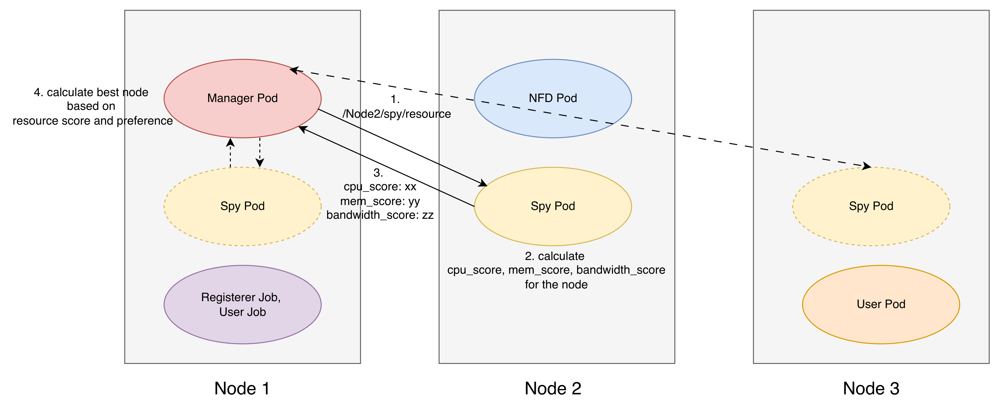

## アーキテクチャ


## 計算ロジック

### Spy

Node の CPU・メモリの使用率（%）を、それぞれ以下の式で空き容量のスコア（0〜100）に変換:

```text
score = max(0, int((80 - usage) / 80 × 100))
```

帯域は `ens18` の容量（現在は 1 Gbps）に対する送受信帯域の合計使用率を求め、CPU・メモリと同じ式でスコア化する:

```text
usage = (in_bps + out_bps) / capacity × 100
bandwidth_score = max(0, int((80 - usage) / 80 × 100))
```

### Manager

CPU・メモリ・帯域の優先度を重み（`high`: 3、`medium`: 2、`low`: 1、省略時は`medium`）に変換し、各ノードのスコアを計算する。`/Manager/register` の `preference` には `bandwidth` も指定できる。

```text
score = (cpu_score × cpu_weight + mem_score × memory_weight + bandwidth_score × bandwidth_weight) / (cpu_weight + memory_weight + bandwidth_weight)
```

総合スコアが最も高いノードに関数を配置する。
