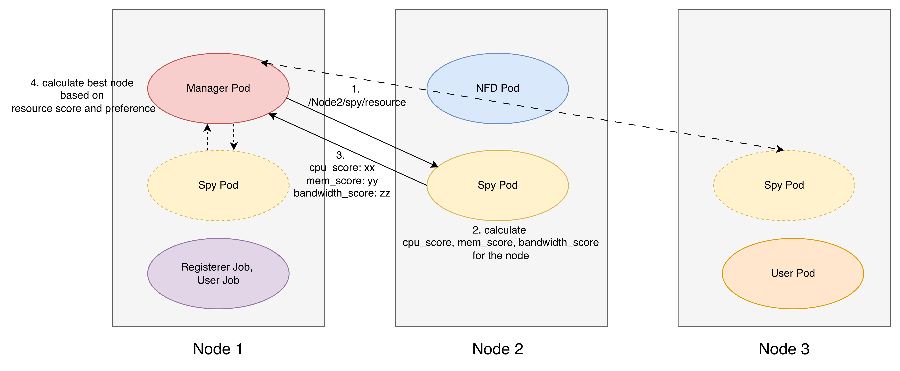

## アーキテクチャ


## 計算ロジック

### Spy

Node の CPU・メモリの使用率（%）を、それぞれ以下の式で空き容量のスコア（0〜100）に変換:

```text
score = max(0, int((80 - usage) / 80 × 100))
```

帯域は `ens18` の容量（現在は 1 Gbps）に対する送受信帯域の合計使用率を求め、CPU・メモリと同じ式でスコア化する:

```text
usage = (in_bps + out_bps) / capacity × 100
bandwidth_score = max(0, int((80 - usage) / 80 × 100))
```

### Manager

Manager は関数の登録要求（`/Manager/register`）を受け取ると、各ノードの Spy から収集したメトリクスを基にノードの評価を行う。
評価および最適な配置アルゴリズム模索のため、以下の3つの計算手法が実装。

#### 手法1: リソース優先度・空き容量重視スコア（`score` / preference_score）
CPU・メモリ・帯域の優先度を重み（`high`: 3、`medium`: 2、`low`: 1、省略時は`medium`）に変換し、各ノードの空き容量スコアを加重平均する。`/Manager/register` の `preference` には `bandwidth` も指定できる。

```text
score = (cpu_score × cpu_weight + mem_score × memory_weight + bandwidth_score × bandwidth_weight) / (cpu_weight + memory_weight + bandwidth_weight)
```

#### 手法2: リソース均等化スコア（`balance_score` / BalancedResourceAllocation）
Kubernetes の `NodeResourcesBalancedAllocation` の思想に基づき、リソース（CPU・メモリ・帯域）の使用率比率が均等になる（特定リソースの偏りや断片化を防ぐ）ノードに高いスコアを与える計算式。
新規関数の `preference`（要求の高さ）を配置による想定増分（`high`: +15%, `medium`: +10%, `low`: +5%）として各リソースの現在使用率に加え、配置後の予測使用率割合（0.0〜1.0）の差の小ささをスコア化する（最大100点）。

```text
# 現在の使用率割合 (Spyのスコアから逆算): fraction_current = max(0, 80 - score × 0.8) / 100
# 想定増分: delta = high: 0.15, medium: 0.10, low: 0.05
f_cpu = min(1.0, f_cpu_current + delta_cpu)
f_mem = min(1.0, f_mem_current + delta_mem)
f_bw  = min(1.0, f_bw_current + delta_bw)

diff = (|f_cpu - f_mem| + |f_mem - f_bw| + |f_bw - f_cpu|) / 3
balance_score = max(0, 100 - diff × 100)
```

#### 手法3: 複合スコア（`combined_score`）
上記2つのスコア（`score` と `balance_score`）に重み付け（初期値 1:1）を行い、両者を統合したスコアを算出する。重みは環境変数 `SCORE_WEIGHT_PREFERENCE` および `SCORE_WEIGHT_BALANCE` で調整可能。

```text
combined_score = (weight_preference × score + weight_balance × balance_score) / (weight_preference + weight_balance)
```

いずれの手法においても、総合スコアが最も高いノードに関数を配置する。
